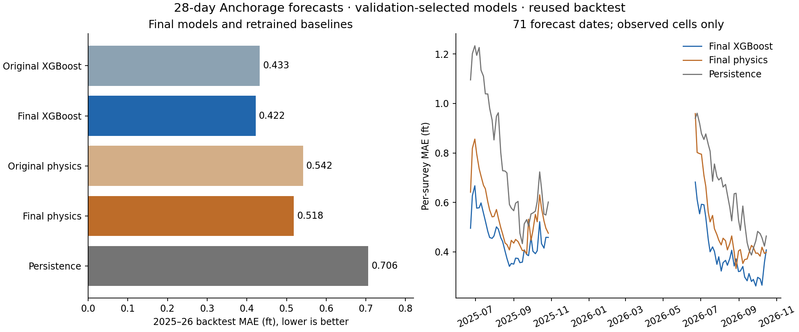
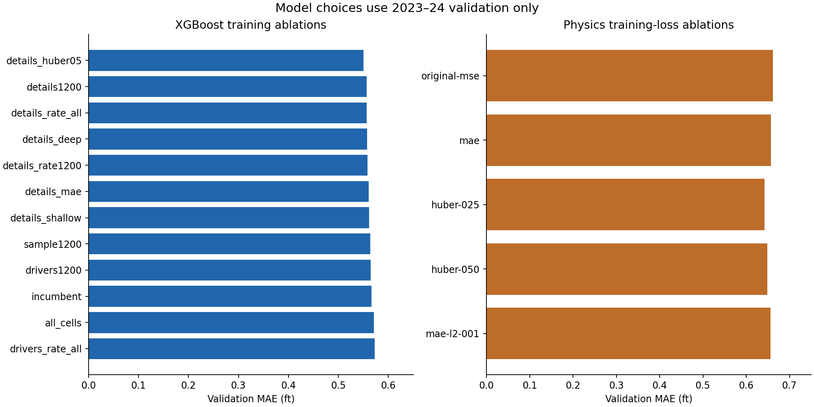
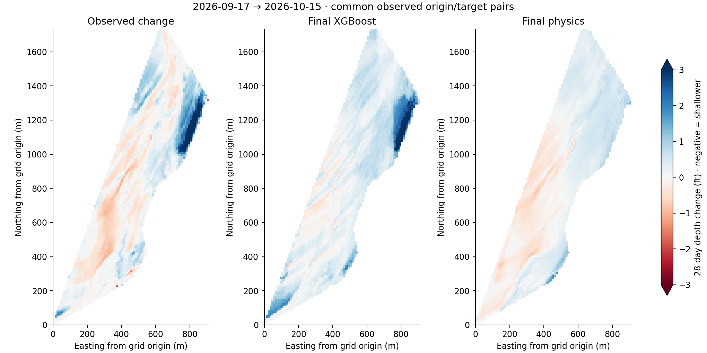

# Final training and platform notes — 17 November 2026

- Work is on `alex-wang`. Both models were freshly trained with this branch's scripts, then independently retrained through `train_xgboost.py` and `train_physics.py`. Reproduced predictions match exactly.
- Upstream `anchorage-dataset` commit `016f0469a7a34756b6dc6d35b757511a7a630fd0` adds a driver-based ConvLSTM notebook. The NPZ is unchanged, verified as Git blob `7b603395ef4992b201bc3dc00ef8c3ca1a22c521`.
- The supplied chronological split has 367 training windows in 2014–2022, 77 validation windows in 2023–2024, and 71 backtest windows in 2025–2026. Each input contains four maps. Evaluation predicts 28 days from the last map.
- Twelve XGBoost configurations and five physics recipes use validation for selection, with selections recorded before final test scoring. The 2025–2026 backtest was inspected in previous work. These results compare development choices on reused data; they provide no independent future-season confirmation.

## Results

| Model | Validation MAE (ft) | 2025–26 MAE (ft) | Backtest RMSE (ft) |
|---|---:|---:|---:|
| Original XGBoost, freshly retrained | 0.566476 | 0.432856 | 0.706781 |
| **Final XGBoost** | **0.549915** | **0.422348** | **0.686280** |
| Original physics MSE, freshly retrained | 0.661549 | 0.541662 | 0.821062 |
| Final physics Huber | 0.642645 | 0.518356 | 0.803592 |
| Persistence, keep origin depth | 0.787386 | 0.706232 | 1.087495 |

- Primary MAE averages cells within each forecast date and then dates equally. Every model is scored on the same 405,181 observed cell–window pairs in the 5,962-cell training-defined core. Future inferred dredging/deepening remains in the target.
- Final XGBoost reduces backtest MAE by 2.43% relative to its original recipe and 40.20% relative to persistence. Its 2025 MAE improves from 0.470738 to 0.453911 ft; 2026 improves from 0.391632 to 0.387999 ft.
- Paired calendar-month block resampling gives a descriptive 95% interval of −0.02545 to −0.00104 ft for final-minus-original XGBoost MAE, using ten month blocks. This interval describes the reused backtest and does not account for all model-search uncertainty.
- Final physics reduces backtest MAE by 4.30%. Its average signed error becomes −0.1096 ft, compared with −0.0473 ft previously. The lower MAE comes with greater shallow bias.



## What changed in training

- **Denser XGBoost fitting.** The original booster sampled 400 eligible cells per window, or 146,800 pairs. The selected fit uses all 2,161,268 measured training pairs. They come from 367 windows and are spatially/temporally correlated. Each window retains equal total training weight. The historical-rate baseline already used all observed training pairs in the original recipe.
- **More precise bathymetric history.** Added day-of-year sine/cosine, three elapsed-day interval rates, recent-minus-longer trend and north/east depth gradients. These accompany the existing 30/90/210 m depth anomaly, roughness, rates and coverage. There are 37 raw features, 37 missing flags, curvature and lead, giving 76 inputs.
- **Actual elapsed time.** Training horizons range from 21–32 days, with 5–11 day history gaps. Validation/backtest use 28-day horizons and seven-day gaps. The selected recipe learns `change × 28 / elapsed_days`, then multiplies predictions by `lead / 28`. Actual survey intervals remain features.
- **Robust boosting and averaging.** Selected pseudo-Huber slope is 0.5 m, with learning rate 0.045, maximum depth 7 and validation early stopping. The average of seeds 42 and 43 improves validation slightly over the single selected fit, from 0.550043 to 0.549915 ft. Both members use identical training-only preprocessing.
- **Measured ablations.** Increasing sampling from 400 to 1,200 without new features improves validation from 0.566476 to 0.563666 ft. Adding the finer season/history/gradient features at 1,200 cells improves it to 0.556678 ft. Using every cell with the original features worsens it to 0.570840 ft. Rate normalization alone also did not improve the 1,200-cell feature variant. The final joint recipe was selected by its complete validation result.
- **Driver decision.** Past tide/river/rain/temperature variants give 0.564525 ft validation at 1,200 cells and 0.572993 ft with all cells plus rate normalization. Comparable map/history variants give 0.556678 and 0.556745 ft. The final XGBoost therefore uses maps/history. Snow was excluded from the trial because it is zero in 99.73% of training past-28-day summaries and all validation/backtest summaries.
- **Physics loss.** Five fixed trials compare MSE, MAE, Huber beta 0.25/0.5 and MAE with stronger weight decay. Huber beta 0.25 wins on validation. It downweights large residuals relative to squared loss. The most extreme 1% of training changes contribute 17.7% of squared target magnitude, motivating this test. The two members select epochs 12 and 30 from 36 epochs; the architecture and 400-cell/window sampling stay fixed.



## Data and missing values

- The 10 m grid provides one resolution across sparse early surveys and dense later surveys. NPZ depths are feet below MLLW; model calculations convert to metres, and export converts back to feet.
- Core eligibility requires at least 80% observed coverage among unique training-window maps. The supplied full-period core is excluded from fitting that rule.
- A missing origin or target excludes the pair from training/scoring. Prediction requires a measured origin. Older-map and driver predictors use medians fitted on training rows plus explicit missingness indicators. Scalers and the historical-rate prior also fit training only. Maps and targets retain their original gaps.
- Older-history missingness rises from 0.55% in training to 3.88% in backtest; origin missingness rises from 0.42% to 3.96%. Indicators and neighborhood coverage expose those changes to the models.
- Physics keeps its independent 84-feature pipeline, with seven- and 28-day past tide, three river, rain, snow and temperature summaries plus coverage. A summary needs at least 80% finite daily coverage. Flow converts cfs to m³/s and uses log1p; tide converts feet to metres; snow converts cm to mm; rain/snow use full-window-equivalent totals after the coverage gate.
- Driver windows end strictly before the origin. Future observed weather/flow/tide and future inferred dredging flags are excluded. The archive's `tide_range_ahead` primarily contains measured future tide, so it is excluded from these models.
- `dredged` is an inferred depth-change flag, rather than a verified operation record. The supplied `masks` remove events through the future target and use a full-period core, so they are excluded from primary training/scoring. Only flags already available by the origin are predictors.
- Data drivers include retrospective weather reanalysis and date-only alignment. Warm-season backtests quantify this setup; live driver availability and winter forecasting need separate evaluation.

## Physics and practical interpretation

```text
Δdepth = (T / 28) × (training_baseline28 + σ fθ(X)) + κ T L(depth_origin)
forecast_depth = measured_depth_origin + Δdepth
```

- Depth is positive downward. `L` is a four-neighbor Laplacian divided by the 10 m spacing squared. Equal/opposite exchanges conserve the diffusion component's depth integral on the observed core. Missing/non-core edges have zero exchange, a computational boundary assumption.
- `κ` stays between 0 and 0.625 m²/day. Fitted members use 0.142725 and 0.106191 m²/day. The `84 → 32 → 32 → 1` tanh source remains unconstrained and can absorb deposition, erosion or dredging. Currents, sediment flux and operations are unavailable for calibrating a full sediment-transport model.
- XGBoost is the default overlay because it has lower validation and backtest error. Physics remains a separately trained comparison model with the same output contract.
- For ≥1 ft shoaling, final XGBoost precision is 74.8% and recall 63.7%, versus 77.4% and 57.9% originally. The model catches more actual shoaling with more false-positive markers. These pooled cell–window metrics use raw model changes in the scoring core; the map shows the common export footprint rounded to 0.01 ft.
- Improvements concentrate on larger changes. For observed absolute change ≥2 ft, XGBoost MAE falls from 1.333 to 1.161 ft. For <1 ft changes, it increases from 0.316 to 0.328 ft. The aggregate 0.422 ft score should be interpreted with that distribution.



## Platform handoff and visualization

- `backend/static/data/anchorage/manifest.json` lists both model IDs, date pairs and GeoJSON URLs. The platform can replace the 13-cell sample layer with the selected URL and reuse its polygon renderer/popups.
- Every GeoJSON preserves collection properties `from_survey` and `predicted_for`, polygon longitude/latitude rings with five points, and feature properties `depth_ft` and `change_ft`. Negative change means shallowing. Depth equals measured origin plus predicted change.
- Each date uses identical polygons for both models. The latest export contains 5,483 cells from the supplied 5,500-cell reference geometry; 17 fail training coverage. The September 14 origin has 5,432 because another 51 starting depths are missing. The attachment contributes geometry only.
- Model/date selection, active-GeoJSON download, fixed depth/change palettes, a fixed-bin histogram and min/median/mean/max now share the selected collection in the branch preview. All depth/change axes and statistics use feet. Histogram end bins retain out-of-range cells, so histogram counts equal map counts.
- The integrated page preserves the platform's Google Maps hybrid satellite view, hidden business/transit icons and Dredging Prediction popup. It loads the selected manifest URL through a Google Data layer, displays both collection dates in cell popups, and styles each cell in constant time using fixed palettes. Histogram statistics and grouped shoaling markers are prepared once per loaded collection. Polygon borders have zero width so 10 m cells remain legible.
- The six slider positions are historical 28-day forecasts from different origins. Required-depth thresholds, reach definitions and validated intervention records are needed before reporting a dredging date.

## Reproduce and inspect

```bash
python -m pip install -r tools/anchorage/requirements-physics.txt
python -m pip install -r tools/anchorage/requirements-analysis.txt
python tools/anchorage/optimize_xgboost.py
python tools/anchorage/optimize_physics.py
python tools/anchorage/analyze_results.py
python tools/anchorage/publish_overlays.py --frames 6
python tools/anchorage/verify_overlays.py
```

- `release_config.json` saves the XGBoost recipe. `train_xgboost.py` and `train_physics.py` reproduce only the selected models without rerunning the search.
- Raw candidate artifacts and trained models stay under ignored `.cache/`. `backend/static/data/anchorage/optimization/summary.json`, `validation_candidates.csv`, `per_window.csv` and `change_size.csv` contain portable numeric results. Source notebooks and model inputs retain their own schemas; exported GeoJSON is shared.
- Verification includes exact fresh-script prediction reproduction, future-map/flag perturbation invariance, origin missingness masks, conserved physics exchange, 24 model/date/layer UI combinations, failure-state clearing, JavaScript/Python syntax and all 12 current GeoJSON contracts/footprints.
